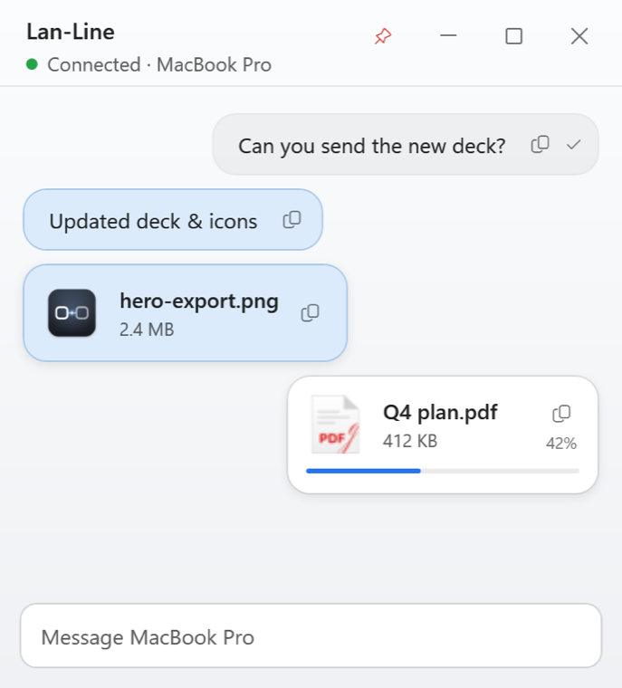
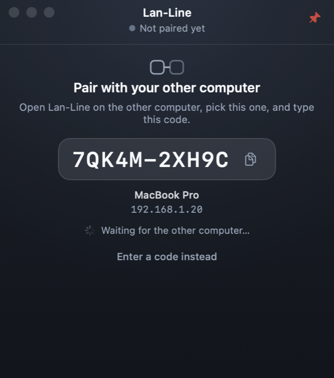

<p align="center">
  
</p>

<h1 align="center">Lan-Line</h1>

<p align="center"><b>Drop here. Grab there.</b><br>
A quiet, pinned window on your Mac and your Windows PC for moving files, pasted screenshots, links and text between them over your local network. No cloud, no accounts.</p>

<p align="center">
  <a href="https://averywrobinson.com/lan-line/"><b>Website</b></a> ·
  <a href="https://github.com/averywrobinson/lan-line/releases"><b>Download</b></a> ·
  <a href="https://github.com/averywrobinson/lan-line/issues/new/choose"><b>Report an issue</b></a>
</p>

<p align="center">
  
  
  
</p>


> **Beta.** Lan-Line 0.9 is an early build that hasn't been tested thoroughly yet. It works day to day, but expect rough edges. Please [open an issue](https://github.com/averywrobinson/lan-line/issues/new/choose) when something breaks.

## Why

If a Mac and a Windows PC share your desk, moving a screenshot or a config snippet twelve inches shouldn't mean DMing yourself, fighting AirDrop's Apple-only wall, waiting for a cloud drive, or mounting a network share. Lan-Line puts one small window on each computer and links them directly.

## Features

- **Always pinned.** The pushpin keeps Lan-Line floating above your work (`⌘P` / `Ctrl+P`).
- **Paste screenshots straight in.** An image on the clipboard becomes a timestamped `pasted-….png` you can drag out on the other side.
- **Copy and delivery checks.** Every message and file has a copy button and a ✓ once the other computer has it.
- **Wakes on receive.** Minimize it; it pops back up when something arrives.
- **Direct and local.** Machine to machine over your LAN: no relay, no compression, no size cap beyond free disk space. Every file is checked with SHA-256.
- **Several computers.** Pair up to 8 Macs and PCs. Send goes to everyone by default, or pick one computer next to Send; each message says who it came from or went to, with "✓ 2/3" until all have it. Settings → Paired computers lets you rename or forget one.
- **Whole folders.** Drop a folder and it arrives as one item, subfolders and empty folders included, shown as one chip with its file count and size. Shortcuts (symlinks) are left out.
- **Too big? Said up front.** If the other computer doesn't have room, both windows say so straight away, before anything is sent.
- **Encrypted end to end.** Everything between the two computers is encrypted (AES-256-GCM), with fresh keys for every connection. The pairing code and the long-term secret are never sent in the clear.
- **Live status.** Emerald means connected; slate means waiting for the other computer.
- **Storage you control.** Keep received files forever or for 1–90 days (or custom), set a storage limit with gentle warnings, and optionally move the oldest files to the Trash / Recycle Bin. Nothing is deleted unless you turn it on.
- **Follows your theme.** Smoked glass in dark mode, a matching light look, on both systems.

## Screenshots

Real windows from this build (sample conversation):

| Mac (dark) | Windows (dark) |
|---|---|
|  |  |
| **Mac (light)** | **Windows (light)** |
|  |  |
| **Pairing with a short code** | **Storage settings** |
|  |  |

## Install

| | Download | Requires |
|---|---|---|
| **macOS** | `Lan-Line-0.9.0-beta.7-mac.dmg` from [Releases](https://github.com/averywrobinson/lan-line/releases) — open it and drag Lan-Line to Applications | macOS 13+ (Apple Silicon or Intel) |
| **Windows** | `Lan-Line-0.9.0-beta.7-windows-setup.exe` from [Releases](https://github.com/averywrobinson/lan-line/releases) — one-click, per-user, no admin; .NET is included | Windows 10 (1809+) or 11, 64-bit |

Homebrew:

```bash
brew install --cask averywrobinson/tap/lan-line
```

**First open (beta builds aren't code-signed yet):**
- **Mac:** macOS says it can't verify Lan-Line. Click *Done*, then open *System Settings → Privacy & Security* and click *Open Anyway*.
- **Windows:** SmartScreen shows "Windows protected your PC". Click *More info → Run anyway*.
- If your firewall asks, allow Lan-Line on private networks.

## Quick start

1. Open Lan-Line on both computers.
2. One computer shows a pairing code (the Mac does by default). On the other, pick it from **On your network** and type the code.
3. The dot turns green. Drop a file, paste a screenshot or type a message on either side, then copy it or drag it out on the other.

Pairing again later: *Lan-Line → Pair with Another Computer…* on the Mac, or right-click the status line on Windows. Two Macs or two PCs pair the same way.

## Keyboard

| Action | macOS | Windows |
|---|---|---|
| Send | `Return` | `Enter` |
| New line | `Shift+Return` | `Shift+Enter` |
| Paste a file or screenshot | `⌘V` | `Ctrl+V` |
| Keep on top | `⌘P` | `Ctrl+P` |
| Minimize | `⌘M` | `Win+↓` |

## Privacy

**Your files and messages never leave your network. Lan-Line only goes online when you click Check for Updates or turn on daily checks.** No servers, no accounts, no analytics or telemetry. Received files land in `Downloads/Lan-Line`.

**Updates:** Lan-Line never downloads or installs anything itself. *Check for Updates…* (Mac: the Lan-Line menu; Windows: the menu under the status line) reads one small file, `https://averywrobinson.com/lan-line/version.json`, with no ID or query string. Daily checks are off unless you turn them on in Settings. The two computers also tell each other, over the encrypted link, about a newer version either one knows of, and show a "Download" link to the release page (only Lan-Line's own pages are ever linked). To hear about releases by email instead, *Watch → Custom → Releases* on this GitHub page.

Since 0.9.0-beta.5, all traffic between the two computers is encrypted. The pairing code only proves that the two computers belong together and is never sent; right after pairing they switch to a random 32-byte secret, which travels encrypted. Every connection derives its own AES-256-GCM keys from a fresh P-256 key exchange, so someone on your network can neither read nor change what you send, and a secret stolen later can't decrypt old traffic. The secret is stored only in your user's app-data folder.

Limits: someone on your network can still see how much is sent and when, and encryption can't protect a computer that is already compromised. Full design and threat model: [ENCRYPTION.md](ENCRYPTION.md).

**Updating from beta.4:** update both computers. beta.5 and later can't talk to beta.4 (there is no unencrypted fallback); until both are updated, the window says "Update Lan-Line on …". beta.5, beta.6 and beta.7 work together; folders need beta.6 or later on both ends, and pairing more than two computers needs beta.7 on the computers with several partners. Your pairing carries over.

## How it works

Each pair of computers keeps one WebSocket connection, encrypted after a short handshake. Text and file metadata are small JSON messages; files stream in 256 KiB chunks and are verified with SHA-256 before they appear. Computers find each other with a UDP broadcast on port 47830. Details: [PROTOCOL.md](PROTOCOL.md).

```
mac/       Swift 6 (SwiftPM): LanLineCore library, LanLine app (AppKit + SwiftUI), XCTest
windows/   .NET 10: LanLine.Core, LanLine.App (WPF), LanLine.Tests, installer/ (Inno Setup)
site/      the website (static HTML)
```

## Build from source

**macOS** (Xcode 16+ / Swift 6):

```bash
cd mac && swift test && ./build-app.sh     # builds and installs ~/Applications/Lan-Line.app
./package.sh                               # dist/Lan-Line-<version>-mac.dmg
```

**Windows** (.NET 10 SDK):

```bash
dotnet run --project windows/LanLine.Tests -c Release   # tests
dotnet run --project windows/LanLine.App                 # the app
```

Installer: `dotnet publish windows/LanLine.App -c Release -r win-x64 --self-contained true -o windows/publish-sc`, then `ISCC windows/installer/LanLine.iss` (Inno Setup 7).

## Feedback

Bugs and ideas are welcome in [Issues](https://github.com/averywrobinson/lan-line/issues/new/choose). Most helpful: both OS versions, the Lan-Line version, and your network setup (Wi-Fi, Ethernet, VPN, VLANs). Security problems: see [SECURITY.md](SECURITY.md).

## License

[MIT](LICENSE) © 2026 Avery Robinson
