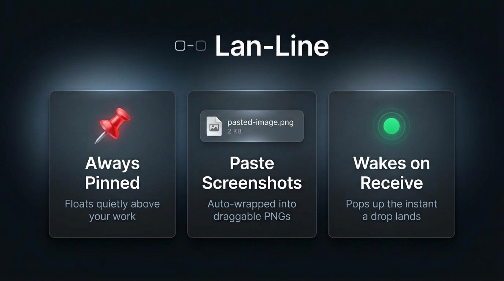

<p align="center">
  
</p>

<h1 align="center">Lan-Line</h1>

<p align="center"><b>Drop here. Grab there.</b><br>
A quiet, pinned window on your Mac and your Windows PC for moving files, pasted screenshots, links and text between them over your local network. No cloud, no accounts.</p>

<p align="center">
  <a href="https://lan-line.averywrobinson.com"><b>Website</b></a> ·
  <a href="https://github.com/averywrobinson/lan-line/releases"><b>Download</b></a> ·
  <a href="https://github.com/averywrobinson/lan-line/issues/new/choose"><b>Report an issue</b></a>
</p>

<p align="center">
  
  
  
</p>


> **Beta.** Lan-Line 0.9 is an early build that hasn't been tested thoroughly yet. It works day to day, but expect rough edges. Please [open an issue](https://github.com/averywrobinson/lan-line/issues/new/choose) when something breaks.

## Why

If a Mac and a Windows PC share your desk, moving a screenshot or a config snippet twelve inches shouldn't mean DMing yourself, fighting AirDrop's Apple-only wall, waiting for a cloud drive, or mounting a network share. Lan-Line puts one small window on each computer and links them directly.

## Features

- **Always pinned.** The pushpin keeps Lan-Line floating above your work (`⌘P` / `Ctrl+P`).
- **Paste screenshots straight in.** An image on the clipboard becomes a timestamped `pasted-….png` you can drag out on the other side.
- **Copy and delivery checks.** Every message and file has a copy button and a ✓ once the other computer has it.
- **Wakes on receive.** Minimize it; it pops back up when something arrives.
- **Direct and local.** Machine to machine over your LAN: no relay, no compression, no size cap beyond free disk space. Every file is checked with SHA-256.
- **Live status.** Emerald means connected; slate means waiting for the other computer.
- **Follows your theme.** Smoked glass in dark mode, a matching light look, on both systems.



## Install

| | Download | Requires |
|---|---|---|
| **macOS** | `Lan-Line-0.9.0-beta.1-mac.dmg` from [Releases](https://github.com/averywrobinson/lan-line/releases) — open it and drag Lan-Line to Applications | macOS 14+, Apple Silicon |
| **Windows** | `Lan-Line-0.9.0-beta.1-windows-setup.exe` from [Releases](https://github.com/averywrobinson/lan-line/releases) — one-click, per-user, no admin; .NET is included | Windows 10 (1809+) or 11, 64-bit |

Homebrew:

```bash
brew install --cask averywrobinson/tap/lan-line
```

**First open (beta builds aren't code-signed yet):**
- **Mac:** macOS says it can't verify Lan-Line. Click *Done*, then open *System Settings → Privacy & Security* and click *Open Anyway*.
- **Windows:** SmartScreen shows "Windows protected your PC". Click *More info → Run anyway*.
- If your firewall asks, allow Lan-Line on private networks.

## Quick start

1. Open Lan-Line on both computers.
2. One computer shows a pairing code (the Mac does by default). On the other, pick it from **On your network** and type the code.
3. The dot turns green. Drop a file, paste a screenshot or type a message on either side, then copy it or drag it out on the other.

Pairing again later: *Lan-Line → Pair with Another Computer…* on the Mac, or right-click the status line on Windows. Two Macs or two PCs pair the same way.

## Keyboard

| Action | macOS | Windows |
|---|---|---|
| Send | `Return` | `Enter` |
| New line | `Shift+Return` | `Shift+Enter` |
| Paste a file or screenshot | `⌘V` | `Ctrl+V` |
| Keep on top | `⌘P` | `Ctrl+P` |
| Minimize | `⌘M` | `Win+↓` |

## Privacy

Everything stays on your network: no servers, no accounts, no analytics or telemetry. Received files land in `Downloads/Lan-Line`. The pairing code is the shared secret; it's stored only in your user's app-data folder. Traffic on the LAN is not encrypted in this beta, so use Lan-Line on networks you trust.

## How it works

Each pair of computers keeps one WebSocket connection. Text and file metadata are small JSON messages; files stream in 256 KiB chunks and are verified with SHA-256 before they appear. Computers find each other with a UDP broadcast on port 47830. Details: [PROTOCOL.md](PROTOCOL.md).

```
mac/       Swift 6 (SwiftPM): FerryCore library, LanLine app (AppKit + SwiftUI), XCTest
windows/   .NET 10: Ferry.Core, Ferry.App (WPF), Ferry.Tests, installer/ (Inno Setup)
site/      the website (static HTML)
```

## Build from source

**macOS** (Xcode 16+ / Swift 6):

```bash
cd mac && swift test && ./build-app.sh     # builds and installs ~/Applications/Lan-Line.app
./package.sh                               # dist/Lan-Line-<version>-mac.dmg
```

**Windows** (.NET 10 SDK):

```bash
dotnet run --project windows/Ferry.Tests -c Release   # tests
dotnet run --project windows/Ferry.App                 # the app
```

Installer: `dotnet publish windows/Ferry.App -c Release -r win-x64 --self-contained true -o windows/publish-sc`, then `ISCC windows/installer/LanLine.iss` (Inno Setup 7).

## Feedback

Bugs and ideas are welcome in [Issues](https://github.com/averywrobinson/lan-line/issues/new/choose). Most helpful: both OS versions, the Lan-Line version, and your network setup (Wi-Fi, Ethernet, VPN, VLANs). Security problems: see [SECURITY.md](SECURITY.md).

## License

[MIT](LICENSE) © 2026 Avery Robinson
