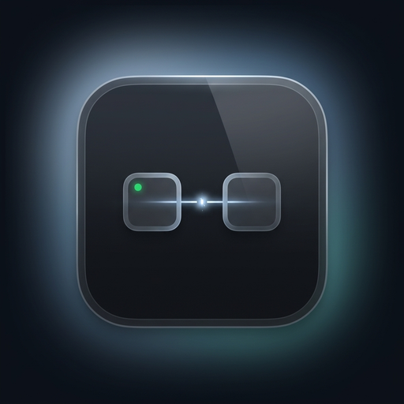
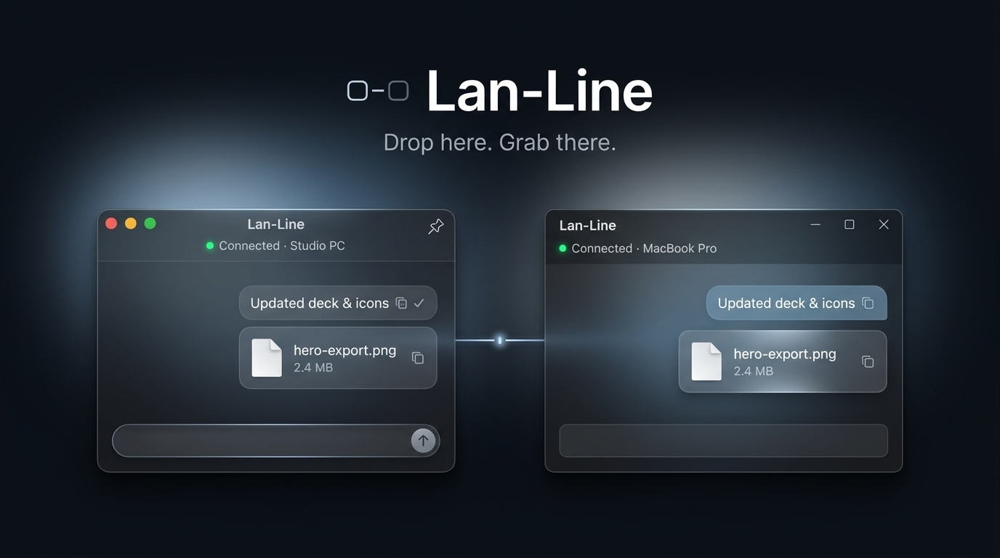
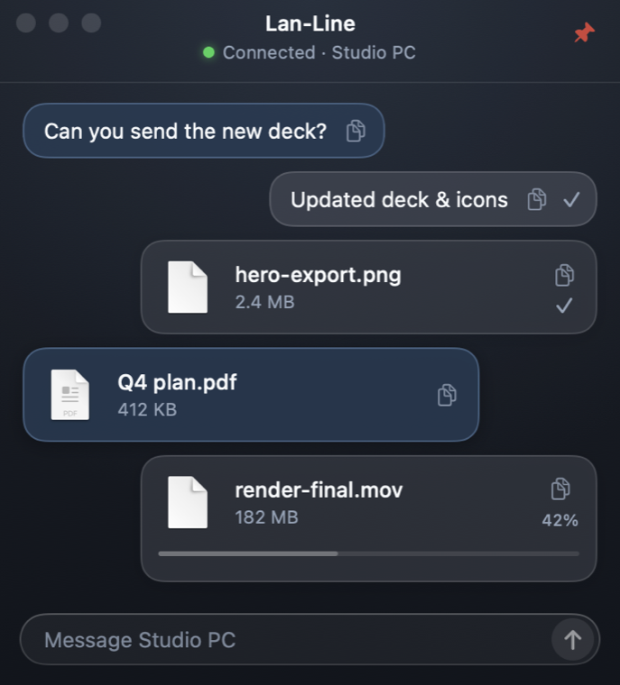
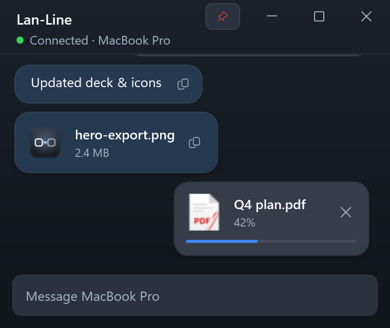
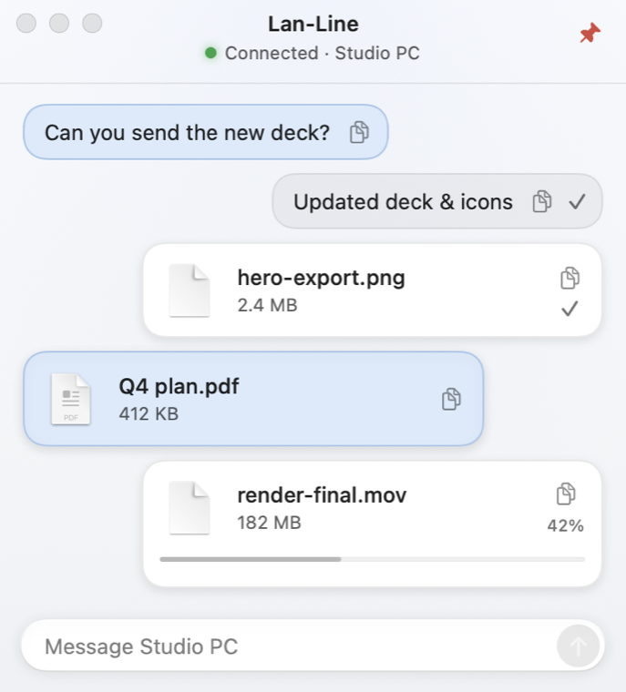
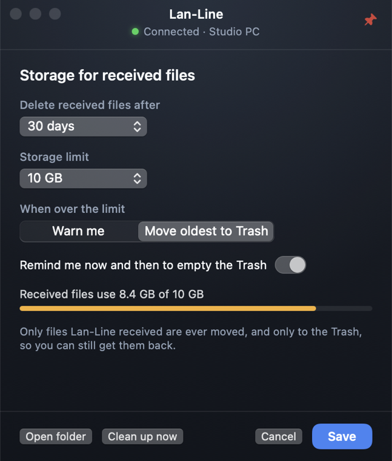

<p align="center">
  
</p>

<h1 align="center">Lan-Line</h1>

<p align="center"><b>Drop here. Grab there.</b><br>
A quiet, pinned window on your Mac and your Windows PC for moving files, folders, pasted screenshots, links and text between them over your local network, encrypted end to end. No cloud, no accounts.</p>

<p align="center">
  <a href="https://averywrobinson.com/lan-line/"><b>Website</b></a> ·
  <a href="https://github.com/averywrobinson/lan-line/releases"><b>Download</b></a> ·
  <a href="https://github.com/averywrobinson/lan-line/issues/new/choose"><b>Report an issue</b></a>
</p>

<p align="center">
  
  
  
</p>



> **Beta.** Lan-Line 0.9 is an early build that hasn't been tested thoroughly yet. It works day to day, but expect rough edges. Please [open an issue](https://github.com/averywrobinson/lan-line/issues/new/choose) when something breaks.

## Why

If a Mac and a Windows PC share your desk, moving a screenshot or a config snippet twelve inches shouldn't mean DMing yourself, fighting AirDrop's Apple-only wall, waiting for a cloud drive, or mounting a network share. Lan-Line puts one small window on each computer and links them directly.

## Features

**Sending**
- **Drop, paste or type.** Files, whole folders (subfolders and empty folders included), pasted screenshots, links and text. A pasted image becomes a timestamped `pasted-….png`.
- **From anywhere.** Mac: right-click → Share → Lan-Line, or drop on the menu bar or Dock icon. Windows: right-click → Send to → Lan-Line, or an optional drop zone at the screen edge. A shortcut can send whatever is on the clipboard.
- **Big files without babysitting.** Live speed and time left, in the window and on the Dock or taskbar. Cancel from either side. If the link drops mid-file, it carries on from where it stopped.
- **Too big? Said up front.** If the other computer doesn't have room, both windows say so before anything is sent.
- **Several computers.** Pair up to 8 Macs and PCs. Send goes to everyone, or pick one next to Send; each item says who it came from or went to, with "✓ 2/3" until all have it.

**Receiving**
- **Tells you when it lands.** The window comes forward, a notification offers Copy or Open, the icon carries a count until you've looked, and a soft chime plays (all optional).
- **One-click copy.** Every message and file has a copy button and a ✓ once the other computer has it. One-time codes get their own Copy button, links become cards, colours show a swatch and code keeps its formatting.
- **Look before you open.** Real thumbnails; press Space on a file to preview it.
- **Lands where you want.** Downloads, the Desktop or any folder, optionally a folder per computer, and optionally shown or opened on arrival.
- **Shared clipboard, if you want it.** Off until you turn it on: copy on one computer, paste on the other. Text and pictures; anything a password manager marks private is never shared.
- **History and search.** The last 1,000 items stay after a restart, on that computer only. `⌘F` / `Ctrl+F` searches them, with filters for text, pictures, files and links.

**The window**
- **Always pinned.** The pushpin keeps Lan-Line floating above your work (`⌘P` / `Ctrl+P`); a shortcut shows or hides it from any app.
- **Stays out of the way.** Close the window and Lan-Line keeps running in the Mac menu bar or the Windows notification area, still receiving. It can open at login. Settings can make closing quit instead.
- **At home on each system.** Liquid Glass on macOS 26, Mica and Acrylic on Windows 11, solid and tidy on older systems; light and dark follow your system. Window opacity is yours to set (40–100 %); text stays fully readable.
- **Readable and reachable.** Its own text size (Windows also follows the system's), Increase Contrast and Windows contrast themes, VoiceOver and Narrator announce what arrives, and every action has a key (`⌘/` / `Ctrl+/` lists them).
- **Storage you control.** Keep received files forever or for 1–90 days, set a storage limit with gentle warnings, and optionally move the oldest files to the Trash / Recycle Bin. Nothing is deleted unless you turn it on.

**Private by design**
- **Direct and local.** Computer to computer over your LAN: no relay, no compression, no size cap beyond free disk space. Every file is checked with SHA-256.
- **Encrypted end to end.** AES-256-GCM with fresh keys for every connection. The pairing code and the long-term secret are never sent in the clear.
- **Updates you can trust.** A notice offers the new version; one click installs it, and only if its signature checks out.

## Screenshots

Real windows from this build (sample conversation):

| Mac (dark) | Windows (dark) |
|---|---|
|  |  |
| **Mac (light)** | **Windows (light)** |
|  |  |
| **Pairing with a short code** | **Storage settings** |
|  |  |

## Install

| | Download | Requires |
|---|---|---|
| **macOS** | `Lan-Line-0.9.0-beta.11-mac.dmg` from [Releases](https://github.com/averywrobinson/lan-line/releases) — open it and drag Lan-Line to Applications | macOS 13+ (Apple Silicon or Intel) |
| **Windows** | `Lan-Line-0.9.0-beta.11-windows-setup.exe` from [Releases](https://github.com/averywrobinson/lan-line/releases) — one-click, per-user, no admin; .NET is included | Windows 10 (1809+) or 11, 64-bit |

Homebrew (Apple Silicon; Intel Macs use the DMG):

```bash
brew trust averywrobinson/tap
brew install --cask averywrobinson/tap/lan-line
```

Homebrew 7 asks you to trust third-party taps; without it, `brew upgrade` may skip Lan-Line. Installing by full name works either way.

**First open:**
- **Mac:** signed and notarized by Apple, so it opens straight away.
- **Windows (not code-signed yet):** SmartScreen shows "Windows protected your PC". Click *More info → Run anyway*.
- If your firewall asks, allow Lan-Line on private networks.

## Quick start

1. Open Lan-Line on both computers.
2. One computer shows a pairing code (the Mac does by default). On the other, pick it from **On your network** and type the code.
3. The dot turns green and a three-card tour shows the basics once. Drop a file, paste a screenshot or type a message on either side, then copy it or drag it out on the other.

Pairing again later: *Lan-Line → Pair with Another Computer…* on the Mac, or right-click the status line on Windows. Two Macs or two PCs pair the same way. The tour is under *Help → Welcome Tour* (Mac) or the status-line menu (Windows).

Closed the window? On a Mac, Lan-Line is in the menu bar (two linked squares); on Windows, in the notification area by the clock (under ^ if Windows tucked it away: drag it onto the taskbar to keep it in view). Click it to show the window; Quit / Exit is in its menu.

Sending from Finder or Explorer: right-click → **Share → Lan-Line** (Mac) or **Send to → Lan-Line** (Windows). On a Mac where Lan-Line isn't in the Share menu, turn it on once in *System Settings → General → Login Items & Extensions → Sharing* (macOS 13–14: *Privacy & Security → Extensions → Sharing*).

## Keyboard

| Action | macOS | Windows |
|---|---|---|
| Send | `Return` | `Enter` |
| New line | `Shift+Return` | `Shift+Enter` |
| Paste a file or screenshot | `⌘V` | `Ctrl+V` |
| Search | `⌘F` | `Ctrl+F` |
| Preview the selected file | `Space` | `Space` |
| Keep on top | `⌘P` | `Ctrl+P` |
| Show or hide from any app | `⌃⌥L` | `Ctrl+Alt+L` |
| List every shortcut | `⌘/` | `Ctrl+/` |
| Minimize | `⌘M` | `Win+↓` |

The show/hide shortcut can be changed in Settings, where you can also set one that sends the clipboard.

## Privacy

**Your files and messages never leave your network.** No servers, no accounts, no analytics or telemetry. Received files land in `Downloads/Lan-Line` unless you pick another folder. The history stays on each computer and is never synced.

**The only times Lan-Line goes online:**
- **Checking for updates:** when you click *Check for Updates…* (Mac: the Lan-Line menu; Windows: the menu under the status line), or once a day if you turn daily checks on. It reads one small file, `https://averywrobinson.com/lan-line/version.json`, with no ID or query string.
- **Installing an update:** when you click *Install* on an update notice. Lan-Line reads the signed `update.json` from the same site, downloads the release file it names from this repository's GitHub Releases, and uses it only if the signature, size and SHA-256 all match. Nothing is downloaded until you click.
- **Link previews:** off unless you turn them on. When on, the computer showing a link fetches that page for its title and picture.

The two computers also tell each other, over the encrypted link, about a newer version either one knows of. To hear about releases by email instead, *Watch → Custom → Releases* on this GitHub page.

**Clipboard sharing** is off until you turn it on, goes only to your paired computers over the same encrypted link, and skips anything marked private (as password managers do).

All traffic between the computers is encrypted. The pairing code only proves that the two computers belong together and is never sent; right after pairing they switch to a random 32-byte secret, which travels encrypted. Every connection derives its own AES-256-GCM keys from a fresh P-256 key exchange, so someone on your network can neither read nor change what you send, and a secret stolen later can't decrypt old traffic. The secret is stored only in your user's app-data folder.

Limits: someone on your network can still see how much is sent and when, and encryption can't protect a computer that is already compromised. Full design and threat model: [ENCRYPTION.md](ENCRYPTION.md).

**Updating from an older beta:** update both computers. Any two betas from beta.5 on can talk to each other; clipboard sharing and carrying on after a dropped connection need beta.10 or later on both ends, and folders need beta.6 or later. beta.4 and earlier can't connect to anything newer; the window says "Update Lan-Line on …". Your pairing carries over.

## How it works

Each pair of computers keeps one WebSocket connection, encrypted after a short handshake. Text and file metadata are small JSON messages; files stream in 256 KiB chunks and are verified with SHA-256 before they appear. Computers find each other with a UDP broadcast on port 47830. Details: [PROTOCOL.md](PROTOCOL.md).

```
mac/       Swift 6 (SwiftPM): LanLineCore library, LanLine app (AppKit + SwiftUI), XCTest
windows/   .NET 10: LanLine.Core, LanLine.App (WPF), LanLine.Tests, installer/ (Inno Setup)
site/      the website (static HTML)
```

## Build from source

**macOS** (Xcode 16+ / Swift 6):

```bash
cd mac && swift test && ./build-app.sh     # builds and installs ~/Applications/Lan-Line.app
./package.sh                               # dist/Lan-Line-<version>-mac.dmg
```

**Windows** (.NET 10 SDK):

```bash
dotnet run --project windows/LanLine.Tests -c Release   # tests
dotnet run --project windows/LanLine.App                 # the app
```

Installer: `dotnet publish windows/LanLine.App -c Release -r win-x64 --self-contained true -o windows/publish-sc`, then `ISCC windows/installer/LanLine.iss` (Inno Setup 7).

## Code signing policy

Free code signing provided by [SignPath.io](https://signpath.io), certificate by [SignPath Foundation](https://signpath.org).

- **Who:** Avery Robinson ([@averywrobinson](https://github.com/averywrobinson)) is the author, reviewer and approver of every release. AI coding assistants help write the code; every change is reviewed, and only Avery approves a signing request.
- **Mac:** the Mac app is signed with Avery's Apple Developer ID and notarized by Apple (since 0.9.0-beta.11); that is separate from SignPath, which covers Windows.
- **What gets signed:** only installers built by this repository's GitHub Actions workflow (`.github/workflows/windows-release.yml`) from a tagged commit of this public source. Windows signing starts once SignPath Foundation approves the project; until then the Windows installer is unsigned and SmartScreen warns about it.
- **Privacy:** Lan-Line sends nothing to anyone but your own paired computers. It has no telemetry, accounts or analytics. It goes online only to check for an update (one small file, no ID), to download an update you chose to install, and, if you turn link previews on, to fetch the pages of links you receive. See the README's privacy notes.
- **MFA:** two-factor authentication is on for every account with access to this repository and to SignPath.

## Feedback

Bugs and ideas are welcome in [Issues](https://github.com/averywrobinson/lan-line/issues/new/choose). Most helpful: both OS versions, the Lan-Line version, and your network setup (Wi-Fi, Ethernet, VPN, VLANs). Security problems: see [SECURITY.md](SECURITY.md).

## License

[MIT](LICENSE) © 2026 Avery Robinson
